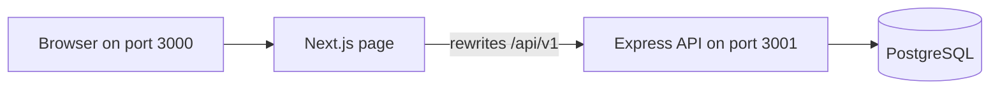

# Coin Vault

Coin Vault is a small virtual-currency store. People buy Gold Coins with mocked payments, then spend those coins on gaming skins, emotes, and battle passes.

The full schema, endpoints, and status codes are in [docs/design-doc.md](docs/design-doc.md).


https://github.com/user-attachments/assets/0f9884cb-8c23-4eba-9f7d-0a0ab3599d5f


## Problem

A game store needs one currency, Gold Coins, for its catalog. Real-money checkout can be faked for this exercise. The store still has to keep a correct balance: every coin added or spent is recorded, a purchase either finishes completely or does not happen, and a confirmed top-up credits coins only once. One-time items can be owned only once. The balance cannot go negative.

## Solution

The app is two npm workspaces behind one page.

- The Next.js page in `frontend/` is what you open in the browser. It remembers the chosen user in `localStorage` and sends that id as `X-User-Id`.
- The Express API in `backend/` owns the rules. It checks input with zod, writes through one Postgres pool, and records every coin change in a ledger.
- Buying coins is two steps: create a pending top-up for a fixed coin pack, then confirm it. Confirming the same top-up again does not add coins a second time.
- Buying a product snapshots its price. Seeded products are one-time, so a second purchase of the same item is rejected. Inventory lists those owned items.
- `user_balances.balance` is the current total. It stays equal to the sum of that user's ledger entries.

There is no login and no real payment provider. The browser user id is trusted.

## Architecture



`npm start` builds the page, then runs both processes. The page stays on port 3000. The API listens on port 3001. Requests to `/api/v1` are forwarded by `frontend/next.config.ts`.

A user flow looks like this:

1. Open the page and create a user with a display name and email, or continue as someone already listed.
2. Buy a coin pack, then confirm it. The balance increases by the pack's coin amount.
3. Buy a product. The balance decreases by that product's coin price, a ledger row is written, and the item appears in inventory.
4. Use Back, or the browser Back button, to return to the user list. Refreshing `/vault` keeps that user.

## Codebase structure

```
backend/          Express API, SQL, and Jest tests
  src/            routes, services, validators, database pool
  sql/            schema.sql, seed.sql, reset.sql
  tests/          acceptance tests
frontend/         Next.js page
  app/            home at / and the signed-in store at /vault
docs/design-doc.md
```

Routes stay thin. Business rules live in `backend/src/services/`. `DATABASE_URL` is read only in `backend/src/db/pool.ts`.

## Database design

Coins are integers. Real-money prices exist only on coin packs, in cents.

| Table | Role |
| --- | --- |
| `users` | Display name and unique email |
| `user_balances` | One current balance per user. A check constraint keeps it at zero or above |
| `coin_packs` | Fixed packs: Starter (100 coins, 99¢), Value (500 coins, 449¢), Mega (1200 coins, 999¢) |
| `products` | Catalog: Neon Blade (300), Victory Dance (150), Season 1 Battle Pass (500), Mystery Skin Crate (200). All seeded products are one-time |
| `top_ups` | A pending or succeeded coin purchase. Coins and cents are copied onto the row |
| `purchases` | A product purchase. Price is copied onto the row. One-time items are unique per user |
| `coin_ledger` | Every credit and debit. A top-up credits coins. A purchase debits coins |

`npm run db:schema` creates these tables. It is for an empty database. `npm run db:reset` clears users and their activity, then loads the catalog seed. Run that reset once on a new app database. Running it again inserts a second copy of the packs and products.

## Run it locally

These steps are for a Mac with [Homebrew](https://brew.sh). You need Node.js 18 or later. The page uses a database named `coin_vault`. The tests use a separate database named `coin_vault_test` and clear user rows there before every test.

The API connects with SSL and accepts a self-signed certificate. pgAdmin can still connect with SSL turned off. Both use the same Postgres server.

### 1. Install PostgreSQL and pgAdmin

```bash
brew install postgresql@15
brew install --cask pgadmin4
echo 'export PATH="$(brew --prefix postgresql@15)/bin:$PATH"' >> ~/.zshrc
source ~/.zshrc
brew services start postgresql@15
```

Check that the server answers on the local socket. This uses your Mac account, which Homebrew creates as the database superuser:

```bash
psql -d postgres -c "SELECT version();"
```

### 2. Turn SSL on

Find the data directory, then create a certificate there:

```bash
DATA_DIR="$(psql -d postgres -Atc "SHOW data_directory;")"
cd "$DATA_DIR"
openssl req -new -x509 -days 3650 -nodes -text \
  -out server.crt \
  -keyout server.key \
  -subj "/CN=localhost"
chmod 600 server.key
```

Open the server config:

```bash
open "$(psql -d postgres -Atc "SHOW config_file;")"
```

Set these values. Add the line when it is missing, and change it when it is commented out:

```
listen_addresses = 'localhost'
port = 5432
ssl = on
ssl_cert_file = 'server.crt'
ssl_key_file = 'server.key'
```

Open the client authentication file:

```bash
open "$(psql -d postgres -Atc "SHOW hba_file;")"
```

Add these two lines so pgAdmin and the API can connect to `127.0.0.1` with a blank password. This is for a development server on your own machine:

```
host all all 127.0.0.1/32 trust
host all all ::1/128 trust
```

Restart Postgres and confirm TCP with SSL works. Replace `YOUR_MAC_USER` with the output of `whoami`:

```bash
brew services restart postgresql@15
psql "postgres://YOUR_MAC_USER@127.0.0.1:5432/postgres?sslmode=require" -c "SELECT 1;"
```

### 3. Create the two databases

```bash
psql -d postgres -c "CREATE DATABASE coin_vault;"
psql -d postgres -c "CREATE DATABASE coin_vault_test;"
```

`coin_vault` is what the page reads and writes. `coin_vault_test` is only for `npm test`.

### 4. Connect pgAdmin

1. Open **pgAdmin 4** from Applications. The first launch asks for a pgAdmin master password. That password unlocks pgAdmin. It is separate from Postgres, and the database password below stays blank.
2. In the left sidebar, right-click **Servers** and choose **Register** → **Server**.
3. On the **General** tab, set the name to `Coin Vault`.
4. On the **Connection** tab, use:

   | Field | Value |
   | --- | --- |
   | Host name/address | `127.0.0.1` |
   | Port | `5432` |
   | Maintenance database | `coin_vault` |
   | Username | your Mac username (`whoami`) |
   | Password | leave blank |
   | Save password | on |

5. On the **SSL** tab, set **SSL mode** to `Disable`.
6. Save. Expand **Servers → Coin Vault → Databases → coin_vault → Schemas → public → Tables**. The table list is empty until the schema step below.

To inspect the test database later, register a second server with the same host, port, and username, and set the maintenance database to `coin_vault_test`.

### 5. Point the app at those databases

From the repo root:

```bash
cp .env.example .env
cp .env.example .env.test
```

`.env` is the page database:

```bash
DATABASE_URL=postgres://YOUR_MAC_USER@127.0.0.1:5432/coin_vault
PORT=3000
```

`.env.test` is the test database:

```bash
DATABASE_URL=postgres://YOUR_MAC_USER@127.0.0.1:5432/coin_vault_test
```

Leave the password out of the URL when local connections use `trust`. Both files stay on your machine. They are listed in `.gitignore`.

### 6. Install, create tables, and load the catalog

```bash
npm install
npm run db:schema
npm run db:reset
```

`db:schema` creates the tables in `coin_vault`. `db:reset` then loads the three coin packs and four products. Run `db:reset` once on a new app database. Running it again inserts another copy of those packs and products.

In pgAdmin, right-click `coin_packs` or `products` and choose **View/Edit Data → All Rows**. You should see Starter Pack, Value Pack, Mega Pack, Neon Blade, Victory Dance, Season 1 Battle Pass, and Mystery Skin Crate. `users` is empty until you create one in the page.

The test database does not need this step. `npm test` creates its schema and catalog when they are missing.

### 7. Start the page

```bash
npm start
```

That builds the Next.js page and starts both processes. Open [http://localhost:3000](http://localhost:3000).

The page listens on port 3000. The API listens on port 3001, even though `.env` contains `PORT=3000`. The browser calls `/api/v1` on port 3000, and Next.js forwards those calls to the API.

On the page:

1. Create a user with a display name and an email.
2. Buy a coin pack, then confirm it. The balance increases.
3. Buy a product. The balance decreases, a transaction appears, and the item appears in inventory.
4. Refresh the page. The same user comes back.
5. In pgAdmin, refresh `coin_vault` and open `users`, `user_balances`, `purchases`, and `coin_ledger` to see those rows.

### 8. Run the tests

```bash
npm test
```

Jest reads `.env.test` and runs against `coin_vault_test`. Before each test it removes users, balances, top-ups, purchases, and ledger rows in that database. `coin_vault` stays as you left it in the browser. After the suite, `coin_vault_test` still has the catalog, plus whatever the last test inserted.
