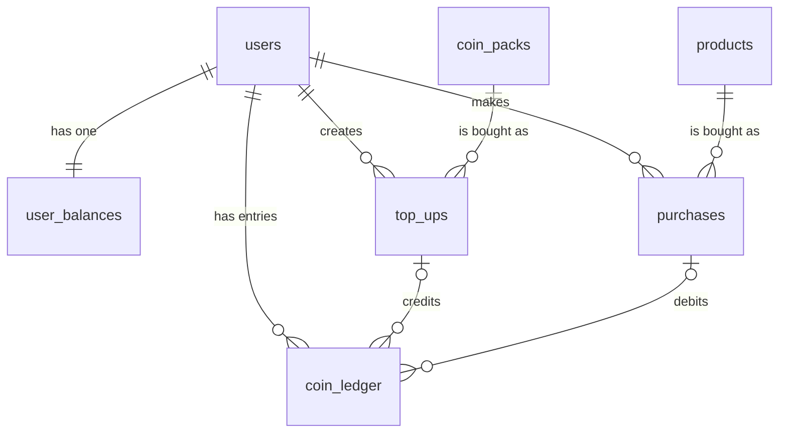

# Coin Vault: Design Doc

## 1. Scope

**Problem (verbatim):** "You are building coin vault, a virtual currency platform for say a gaming products store. Users buy Gold Coins using real money (payment can be mocked). Gold Coins are the only currency accepted on the platform. Users then spend these coins to purchase digital products such as gaming skins, emotes, and battle passes from a product catalog."

**In scope**
- Users (created via API, identified by `X-User-Id` header)
- Coin packs (fixed, seeded) and mocked top-up flow (create, then confirm)
- Product catalog (seeded, read-only via API)
- Purchases with coins, including one-time vs consumable items
- Coin balance, coin transaction history, owned-item inventory
- Simple frontend that exercises all of the above

**Out of scope**
- Real payment processing, payment webhooks, refunds, chargebacks
- Authentication and authorization (header is trusted)
- Admin APIs for catalog or pack management (seed scripts only)
- Real-money pricing or currency conversion
- Delivering the item to a game client
- Multi-currency support

**Hard rule:** no overspending under concurrency. A user's balance never goes negative, and concurrent purchases never spend the same coins twice.

**Other rules**
1. Every coin movement is recorded in `coin_ledger`. `user_balances.balance` equals the sum of `coin_ledger.delta` for that user.
2. A purchase fully completes or does not happen at all.
3. A top-up credits coins exactly once, even if confirm is called repeatedly.
4. Prices are always in coins. Real-money amounts appear only on top-ups.

---

## 2. Schema

Refinement from the data model review: `coin_ledger` now also checks that the sign of `delta` matches its cause (top-ups credit, purchases debit).

```sql
-- sql/schema.sql
-- Target: PostgreSQL 13+ (gen_random_uuid() is built in).

CREATE TABLE users (
  id           uuid PRIMARY KEY DEFAULT gen_random_uuid(),
  display_name text NOT NULL CHECK (length(trim(display_name)) BETWEEN 1 AND 60),
  email        text NOT NULL CHECK (length(trim(email)) BETWEEN 3 AND 254),
  created_at   timestamptz NOT NULL DEFAULT now()
);

CREATE UNIQUE INDEX users_email_lower ON users (lower(email));

CREATE TABLE coin_packs (
  id          uuid PRIMARY KEY DEFAULT gen_random_uuid(),
  name        text NOT NULL,
  coins       integer NOT NULL CHECK (coins > 0),
  price_cents integer NOT NULL CHECK (price_cents > 0),
  is_active   boolean NOT NULL DEFAULT true
);

CREATE TABLE products (
  id            uuid PRIMARY KEY DEFAULT gen_random_uuid(),
  name          text NOT NULL,
  category      text NOT NULL CHECK (category IN ('skin', 'emote', 'battle_pass')),
  price_coins   integer NOT NULL CHECK (price_coins > 0),
  is_consumable boolean NOT NULL DEFAULT false,
  is_active     boolean NOT NULL DEFAULT true
);

-- One row per user. The row lock on this table serializes all balance changes for that user.
CREATE TABLE user_balances (
  user_id    uuid PRIMARY KEY REFERENCES users(id),
  balance    integer NOT NULL DEFAULT 0 CHECK (balance >= 0),
  updated_at timestamptz NOT NULL DEFAULT now()
);

CREATE TABLE top_ups (
  id           uuid PRIMARY KEY DEFAULT gen_random_uuid(),
  user_id      uuid NOT NULL REFERENCES users(id),
  coin_pack_id uuid NOT NULL REFERENCES coin_packs(id),
  coins        integer NOT NULL CHECK (coins > 0),        -- snapshot
  amount_cents integer NOT NULL CHECK (amount_cents > 0), -- snapshot
  status       text NOT NULL CHECK (status IN ('pending', 'succeeded', 'failed')),
  created_at   timestamptz NOT NULL DEFAULT now(),
  updated_at   timestamptz NOT NULL DEFAULT now()
);

CREATE TABLE purchases (
  id            uuid PRIMARY KEY DEFAULT gen_random_uuid(),
  user_id       uuid NOT NULL REFERENCES users(id),
  product_id    uuid NOT NULL REFERENCES products(id),
  price_coins   integer NOT NULL CHECK (price_coins > 0), -- snapshot
  is_consumable boolean NOT NULL,                         -- snapshot, needed by the index below
  created_at    timestamptz NOT NULL DEFAULT now()
);

-- One-time items: a user can own each non-consumable product at most once.
-- Enforced in the database so concurrent requests cannot both succeed.
CREATE UNIQUE INDEX purchases_one_time_owned
  ON purchases (user_id, product_id)
  WHERE is_consumable = false;

CREATE TABLE coin_ledger (
  id            bigint GENERATED ALWAYS AS IDENTITY PRIMARY KEY,
  user_id       uuid NOT NULL REFERENCES users(id),
  delta         integer NOT NULL CHECK (delta <> 0),
  balance_after integer NOT NULL CHECK (balance_after >= 0),
  top_up_id     uuid REFERENCES top_ups(id),
  purchase_id   uuid REFERENCES purchases(id),
  created_at    timestamptz NOT NULL DEFAULT now(),
  -- exactly one cause, and the sign must match it
  CHECK (
    (top_up_id IS NOT NULL AND purchase_id IS NULL AND delta > 0) OR
    (purchase_id IS NOT NULL AND top_up_id IS NULL AND delta < 0)
  )
);

CREATE INDEX coin_ledger_user_order   ON coin_ledger (user_id, created_at DESC, id DESC);
CREATE INDEX purchases_user_order     ON purchases (user_id, created_at DESC, id DESC);
CREATE INDEX top_ups_user             ON top_ups (user_id);
```

### Seed data

```sql
-- sql/seed.sql
INSERT INTO coin_packs (name, coins, price_cents) VALUES
  ('Starter Pack', 100, 99),
  ('Value Pack',   500, 449),
  ('Mega Pack',   1200, 999);

INSERT INTO products (name, category, price_coins, is_consumable) VALUES
  ('Neon Blade',            'skin',        300, false),
  ('Victory Dance',         'emote',       150, false),
  ('Season 1 Battle Pass',  'battle_pass', 500, false),
  ('Mystery Skin Crate',    'skin',        200, false);
```

### Reset script (used before each test run)

```sql
-- sql/reset.sql
TRUNCATE coin_ledger, purchases, top_ups, user_balances, users RESTART IDENTITY CASCADE;
UPDATE coin_packs SET is_active = true;
UPDATE products   SET is_active = true;
```

---

## 3. Relationships



---

## 4. Endpoints

Base path: `/api/v1`. All identity comes from the `X-User-Id` header (UUID) on `/me/*` routes and on `POST /purchases` and `POST /top-ups`.

**Error shape (every error):**
```json
{ "error": { "code": "snake_case_code", "message": "human readable" } }
```

**Pagination:** `?limit` (integer, 1 to 100, default 20; out of range → 400 `validation_error`) and `?cursor` (opaque string, returned as `next_cursor`). Ordering is `created_at DESC, id DESC`.

### 4.1 `POST /users`
- Body: `{ "display_name": string, "email": string }`. Both required.
  - `display_name`: trimmed length 1 to 60.
  - `email`: trimmed, stored lowercase, valid email, length 3 to 254.
- 201: `{ "id": uuid, "display_name": string, "email": string, "balance": 0 }`
- 400 `validation_error`
- 409 `email_taken` when another user already has that email, compared case-insensitively.

### 4.1b `GET /users`
- No header. Used by the page to continue as an existing user.
- 200: `{ "items": [{ "id": uuid, "display_name": string, "email": string | null, "balance": integer }] }`
- Ordered by `display_name`, then `created_at`. `email` is null only for rows created before the column existed.

### 4.2 `GET /coin-packs`
- 200: `{ "items": [{ "id", "name", "coins", "price_cents" }] }`. Active packs only, ordered by `price_cents ASC`.

### 4.3 `GET /products`
- Query: `?category` optional, one of `skin`, `emote`, `battle_pass`.
- 200: `{ "items": [{ "id", "name", "category", "price_coins", "is_consumable" }] }`. Active only.
- 400 `validation_error` (bad category)

### 4.4 `GET /me/balance`
- Header: `X-User-Id` required.
- 200: `{ "user_id": uuid, "balance": integer }`
- 400 `missing_user_header` (no header)
- 400 `invalid_user_id` (not a UUID)
- 404 `user_not_found`

### 4.5 `POST /top-ups`
- Header: `X-User-Id` required.
- Body: `{ "coin_pack_id": uuid }`
- 201: `{ "id", "status": "pending", "coins", "amount_cents" }`
- 400 `missing_user_header` / `invalid_user_id` / `validation_error`
- 404 `user_not_found`
- 404 `coin_pack_not_found` (missing or inactive)

### 4.6 `POST /top-ups/:id/confirm`
- Header: `X-User-Id` required. Path `:id` must be a UUID.
- Body: none. This is the mocked payment success.
- 200: `{ "id", "status": "succeeded", "balance": integer }`
- 200 on repeat call (already `succeeded`): same body, no coins credited.
- 404 `top_up_not_found` (missing, or belongs to another user; do not reveal which)
- 409 `top_up_not_pending` (status is `failed`)
- 400 `missing_user_header` / `invalid_user_id`

### 4.7 `POST /purchases`
- Header: `X-User-Id` required.
- Body: `{ "product_id": uuid }`
- 201: `{ "id", "product_id", "price_coins", "balance_after": integer }`
- 400 `missing_user_header` / `invalid_user_id` / `validation_error`
- 404 `user_not_found`
- 404 `product_not_found` (missing or inactive)
- 402 `insufficient_coins`
- 409 `already_owned` (one-time item already owned)

### 4.8 `GET /me/transactions`
- Header: `X-User-Id`. Query: `?limit`, `?cursor`.
- 200: `{ "items": [{ "id": bigint, "delta", "balance_after", "type": "top_up" | "purchase", "created_at" }], "next_cursor": string | null }`
  - `type` is derived: `top_up` if `top_up_id` is set, otherwise `purchase`.
- 404 `user_not_found`

### 4.9 `GET /me/inventory`
- Header: `X-User-Id`.
- 200: `{ "items": [{ "product_id", "name", "category", "purchased_at" }] }`. Non-consumable purchases only, newest first.
- 404 `user_not_found`

---

## 5. Transaction and concurrency plan

### 5.1 Lock order (global)

Every transaction acquires locks in this order: `top_ups` → `user_balances`. Inserts into `purchases` and `coin_ledger` happen after the balance lock. Following one order everywhere prevents deadlocks.

### 5.2 Create user (4.1)

```
BEGIN;
SELECT id FROM users WHERE lower(email) = lower($email);
-- if a row exists: ROLLBACK, 409 email_taken
INSERT INTO users (display_name, email) VALUES ($1, $2) RETURNING id, display_name, email;
INSERT INTO user_balances (user_id, balance) VALUES ($id, 0);
-- unique violation on users_email_lower (23505) → ROLLBACK, 409 email_taken
COMMIT;
```
Rollback on any error.

### 5.3 Create top-up (4.5)

No lock needed. One statement:
```sql
INSERT INTO top_ups (user_id, coin_pack_id, coins, amount_cents, status)
SELECT $1, cp.id, cp.coins, cp.price_cents, 'pending'
FROM coin_packs cp
WHERE cp.id = $2 AND cp.is_active = true
RETURNING id, status, coins, amount_cents;
```
- If 0 rows: first check that the user exists (`SELECT 1 FROM users WHERE id = $1`). If not, 404 `user_not_found`. Otherwise 404 `coin_pack_not_found`.
- If the FK on `user_id` fails (23503), map to 404 `user_not_found`.

### 5.4 Confirm top-up (4.6)

```
BEGIN;
SELECT id, user_id, coins, status FROM top_ups
  WHERE id = $1 AND user_id = $2
  FOR UPDATE;                                   -- 0 rows → ROLLBACK, 404 top_up_not_found

-- status = 'succeeded' → ROLLBACK, return 200 with current balance (idempotent)
-- status = 'failed'    → ROLLBACK, return 409 top_up_not_pending

UPDATE top_ups SET status = 'succeeded', updated_at = now() WHERE id = $1;

UPDATE user_balances SET balance = balance + $coins, updated_at = now()
  WHERE user_id = $2
  RETURNING balance;                            -- the balance row lock is taken here

INSERT INTO coin_ledger (user_id, delta, balance_after, top_up_id)
  VALUES ($2, $coins, $balance, $1);

COMMIT;
```

### 5.5 Purchase (4.7)

```
BEGIN;

SELECT price_coins, is_consumable FROM products
  WHERE id = $1 AND is_active = true;           -- read price; 0 rows → ROLLBACK, 404 product_not_found

SELECT balance FROM user_balances
  WHERE user_id = $2
  FOR UPDATE;                                   -- lock; 0 rows → ROLLBACK, 404 user_not_found
-- balance < price_coins → ROLLBACK, 402 insufficient_coins

INSERT INTO purchases (user_id, product_id, price_coins, is_consumable)
  VALUES ($2, $1, $price, $consumable)
  RETURNING id;                                 -- unique violation 23505 → ROLLBACK, 409 already_owned

UPDATE user_balances SET balance = balance - $price, updated_at = now()
  WHERE user_id = $2
  RETURNING balance;

INSERT INTO coin_ledger (user_id, delta, balance_after, purchase_id)
  VALUES ($2, -$price, $balance, $purchase_id);

COMMIT;
```

**Rollback triggers:** any error thrown inside the transaction, including:
- 23505 unique violation → 409
- 23514 check violation on `balance >= 0` → 402 (backstop; should not occur if the lock is taken)
- 23503 foreign key violation → 404
- any crash or timeout before COMMIT

The client is always released back to the pool in a `finally` path.

### 5.6 Why the lock works for the hard rule

- All balance changes for a user go through the `user_balances` row lock.
- Two concurrent purchases for the same user are serialized at `SELECT ... FOR UPDATE`. The second reads the balance after the first commits.
- Purchases for different users do not block each other.
- `CHECK (balance >= 0)` is a database backstop independent of application code.
- The partial unique index serializes one-time ownership the same way, as a second guard.

**Example:** balance 100, two concurrent requests for a 60-coin item. A locks, reads 100, debits to 40, commits. B locks, reads 40, returns 402. Exactly one succeeds.

---

## 6. Edge cases

| Case | Expected result |
|---|---|
| Balance exactly equals price | Succeeds; balance becomes 0 |
| Balance one coin short | 402; no purchase row, no ledger row, balance unchanged |
| Concurrent purchases whose total exceeds balance | Exactly one succeeds; others get 402 |
| Same one-time item bought twice (sequential) | Second gets 409; balance unchanged |
| Same one-time item bought twice (concurrent) | One succeeds; the other gets 409 or 402 but never both succeed |
| Consumable bought twice | Both succeed; two ledger rows |
| Inactive or unknown product | 404 `product_not_found` |
| Confirm the same top-up twice | Coins credited once; second call returns 200 with `succeeded` |
| Confirm two different top-ups concurrently | Both credit once each (separate rows) |
| Confirm a top-up owned by another user | 404 `top_up_not_found` |
| Confirm a `failed` top-up | 409 `top_up_not_pending` |
| Pack deactivated after a pending top-up was created | Confirm still credits the snapshotted coins |
| Product price changes after catalog load | Purchase charges the price in the DB at purchase time and returns it |
| Crash after balance UPDATE, before COMMIT | Full rollback; balance and ledger unchanged |
| Missing `X-User-Id` | 400 `missing_user_header` |
| Malformed UUID in header or path | 400 `invalid_user_id` (header) or 400 `validation_error` (body or path) |
| Unknown user on `/me/*` | 404 `user_not_found` |
| `limit` 0, negative, or above 100 | 400 `validation_error` |
| Zero or negative price or coins in seed or insert | Rejected by zod and by CHECK constraints |
| `display_name` empty or whitespace only | 400 `validation_error` |
| Missing or invalid `email` | 400 `validation_error` |
| Create a user with an email that already exists | 409 `email_taken`; no second user row |
| Ledger sum drift (should never happen) | Test fails; see acceptance test A9 |

---

## 7. Acceptance tests

Each test runs against a freshly reset database (`sql/reset.sql` then `sql/seed.sql`). "DB check" is the state to verify after the action.

**A1. Create user**
- Action: `POST /users` with `{ "display_name": "Asha", "email": "asha@example.com" }`
- Expected: 201, balance 0
- DB check: one `users` row, one `user_balances` row with balance 0, no ledger rows

**A2. Top-up happy path**
- Setup: user U with balance 0
- Action: `POST /top-ups` with Starter Pack id; then `POST /top-ups/:id/confirm`
- Expected: create returns 201 pending with coins 100, amount_cents 99; confirm returns 200 with balance 100
- DB check: `top_ups.status = 'succeeded'`; one ledger row with delta 100, balance_after 100, `top_up_id` set

**A3. Top-up confirm is idempotent**
- Setup: A2 done
- Action: confirm the same top-up again
- Expected: 200, balance still 100
- DB check: still one ledger row; balance 100

**A4. Purchase happy path**
- Setup: U with balance 500
- Action: `POST /purchases` with Neon Blade (300)
- Expected: 201, balance_after 200
- DB check: one `purchases` row; `user_balances.balance = 200`; ledger row delta -300, balance_after 200, `purchase_id` set

**A5. Insufficient coins**
- Setup: U with balance 100
- Action: purchase Neon Blade (300)
- Expected: 402 `insufficient_coins`
- DB check: no new purchase or ledger rows; balance still 100

**A6. One-time item cannot be bought twice**
- Setup: U with balance 1000, already owns Neon Blade
- Action: purchase Neon Blade again
- Expected: 409 `already_owned`
- DB check: balance unchanged; still one purchase row

**A7. Mystery Skin Crate is one-time**
- Setup: U with balance 500
- Action: purchase Mystery Skin Crate (200) twice
- Expected: first 201 with balance_after 300; second 409 `already_owned`
- DB check: one purchase row; one purchase ledger row; balance stays 300

**A8. Concurrent purchases do not overspend (the hard rule)**
- Setup: U with balance 100
- Setup detail: insert a test product directly into `products` with `price_coins = 60` and `is_consumable = true`, so repeat purchases are allowed and only the balance decides the outcome.
- Action: send 10 concurrent `POST /purchases` for that product using `Promise.all`.
- Expected: exactly 1 request returns 201; the other 9 return 402 `insufficient_coins`. Balance ends at 40.
- DB check: one new purchase row; `user_balances.balance = 40`; ledger sum equals balance; no negative balance.

**A9. Ledger invariant**
- Setup: any sequence of A2 to A7 actions
- Action: none; run the check query after the test
- Expected: for each user, `user_balances.balance = SUM(coin_ledger.delta)`
- DB check query:
```sql
SELECT ub.user_id
FROM user_balances ub
LEFT JOIN coin_ledger cl ON cl.user_id = ub.user_id
GROUP BY ub.user_id, ub.balance
HAVING ub.balance <> COALESCE(SUM(cl.delta), 0);
-- expected: zero rows
```

**A10. Cross-user isolation**
- Setup: users U1 and U2; U1 creates a top-up
- Action: U2 calls confirm on U1's top-up id
- Expected: 404 `top_up_not_found`
- DB check: U1 balance unchanged; top-up still pending

**A11. Header validation**
- Action: `GET /me/balance` with no header; then with `X-User-Id: not-a-uuid`
- Expected: 400 `missing_user_header`; then 400 `invalid_user_id`

**A12. Pagination**
- Setup: U with 25 ledger rows
- Action: `GET /me/transactions?limit=20`, then with `next_cursor`
- Expected: first page 20 items with non-null `next_cursor`; second page 5 items with `next_cursor: null`; no duplicates across pages

**A13. Inventory**
- Setup: U buys Neon Blade and Mystery Skin Crate
- Action: `GET /me/inventory`
- Expected: contains Neon Blade and Mystery Skin Crate

---

## 8. Done criteria and out of scope

### Done when
- [ ] `sql/schema.sql`, `sql/seed.sql`, `sql/reset.sql` apply cleanly to a fresh hosted Postgres
- [ ] All 9 endpoints implemented with the status codes and error codes above
- [ ] Every purchase and top-up path uses the locking order in section 5
- [ ] Tests A1 to A13 pass, including the concurrency test A8, run repeatedly (at least 5 times)
- [ ] Ledger invariant (A9) holds after every test
- [ ] Frontend can: create a user, view packs and catalog, top up, buy an item, see balance, transactions, and inventory, and see clear messages for 402 and 409
- [ ] No credentials in code; `DATABASE_URL` read from the environment
- [ ] `README.md` with setup and run commands

### Out of scope
Real payments and webhooks, authentication, refunds, admin APIs, multi-currency, delivery to game clients, rate limiting, and real-money pricing.

---

## 9. Questions for the interviewer and stretch items

### Assumptions in use (confirm or override)
1. Seeded products are one-time and can be bought once. A product inserted with `is_consumable = true` can still be bought repeatedly.
2. Top-up packs are fixed and seeded, not user-chosen amounts.
3. Identity is the `X-User-Id` header. No login.
4. Payment confirmation is an instant mocked call, separate from creating the top-up.

### Stretch items (only after everything above passes)
- `Idempotency-Key` header on `POST /purchases` and `POST /top-ups`, so client retries never double-charge
- Refunds that reverse a purchase via a negative-to-positive ledger entry
- A payment webhook endpoint that confirms top-ups asynchronously
- Rate limiting per user
- Admin endpoints to create or deactivate packs and products
- Pagination on `/products` and `/coin-packs`

---

## 10. Readiness check

A fresh session with only `AGENTS.md` and this file should be able to build the project without asking about:
- **Schema:** section 2 has exact SQL, including seed and reset.
- **Status codes:** every endpoint in section 4 lists its codes.
- **Lock order:** section 5.1 states it, and 5.4 and 5.5 give exact SQL.
- **Tests:** section 7 lists setup, action, expected result, and DB check for each.

Gaps found in this pass and fixed: the top-up confirm endpoint lacked a `failed`-status response (added 409), the ledger sign rule was missing (added as a CHECK), and the limit validation behavior was ambiguous (fixed as 400).

---

## 11. Build phases

The work is split into phases. Each phase ends with a working, testable slice. Concurrency hardening is deliberately last, so the basic skeleton works first.

### Phase 1: Skeleton (no money movement)
**Goal:** the app runs, talks to the hosted database, and serves read-only data plus user creation.
- Project setup: `package.json` scripts, Express app, `pg` pool, zod, error middleware, `X-User-Id` middleware
- `sql/schema.sql`, `sql/seed.sql`, `sql/reset.sql` applied to the hosted database
- Endpoints: 4.1 `POST /users`, 4.2 `GET /coin-packs`, 4.3 `GET /products`, 4.4 `GET /me/balance`
- Frontend shell: create user, show packs and catalog, show balance
- Tests: A1, A11, plus a check that `/coin-packs` and `/products` return only active rows

**Done when:** a user can be created, the catalog and packs load in the browser, and the balance shows 0.

### Phase 2: Top-ups, sequential
**Goal:** coins can be added to a user's balance through the mocked payment flow.
- Endpoints: 4.5 `POST /top-ups`, 4.6 `POST /top-ups/:id/confirm`
- Transactions (BEGIN, COMMIT, ROLLBACK) and ledger writes, as in section 5.4
- Frontend: buy-pack button that calls create then confirm, and shows the new balance
- Tests: A2, A3, A10

**Done when:** buying a pack adds the right coins once, repeat confirms do nothing, and another user cannot confirm your top-up.

### Phase 3: Purchases, sequential
**Goal:** coins can be spent on products, and the basic rules are enforced.
- Endpoint: 4.7 `POST /purchases`, with the transaction shape from section 5.5
- Frontend: buy button on each catalog item, with clear messages for insufficient coins and already owned
- Tests: A4, A5, A6, A7

**Note:** this phase is correct when run one request at a time. It is not yet safe under concurrent requests. Row locking (`FOR UPDATE`) and the concurrency test come in Phase 5. Do not run load against this build.

**Done when:** a purchase deducts the right coins, one-time items cannot be bought twice, consumables can, and insufficient coins is rejected.

### Phase 4: History and inventory
**Goal:** the user can see where their coins went and what they own.
- Endpoints: 4.8 `GET /me/transactions` with pagination, 4.9 `GET /me/inventory`
- Frontend: transactions list with "load more", and an inventory view
- Tests: A12, A13, A9 (ledger invariant)

**Done when:** history paginates without duplicates, inventory excludes consumables, and the ledger sum matches the balance after every test.

### Phase 5: Concurrency and hardening
**Goal:** the hard rule holds under concurrent requests.
- Add `SELECT ... FOR UPDATE` and the lock order from section 5.1 to the confirm and purchase paths
- Map Postgres errors (23505, 23514, 23503) as in `AGENTS.md` section 5
- Tests: A8 concurrency test, run at least five times in a row
- Optional stretch items from section 9, one at a time

**Done when:** A8 passes every run, A9 holds after every suite, and no route can produce a negative balance.

### Phase rules
- Do not start a phase until the previous phase's "Done when" is met.
- Each phase updates `AGENTS.md` only if the file layout or commands change.
- Changes to the schema, status codes, or lock order are made in the design doc first.
